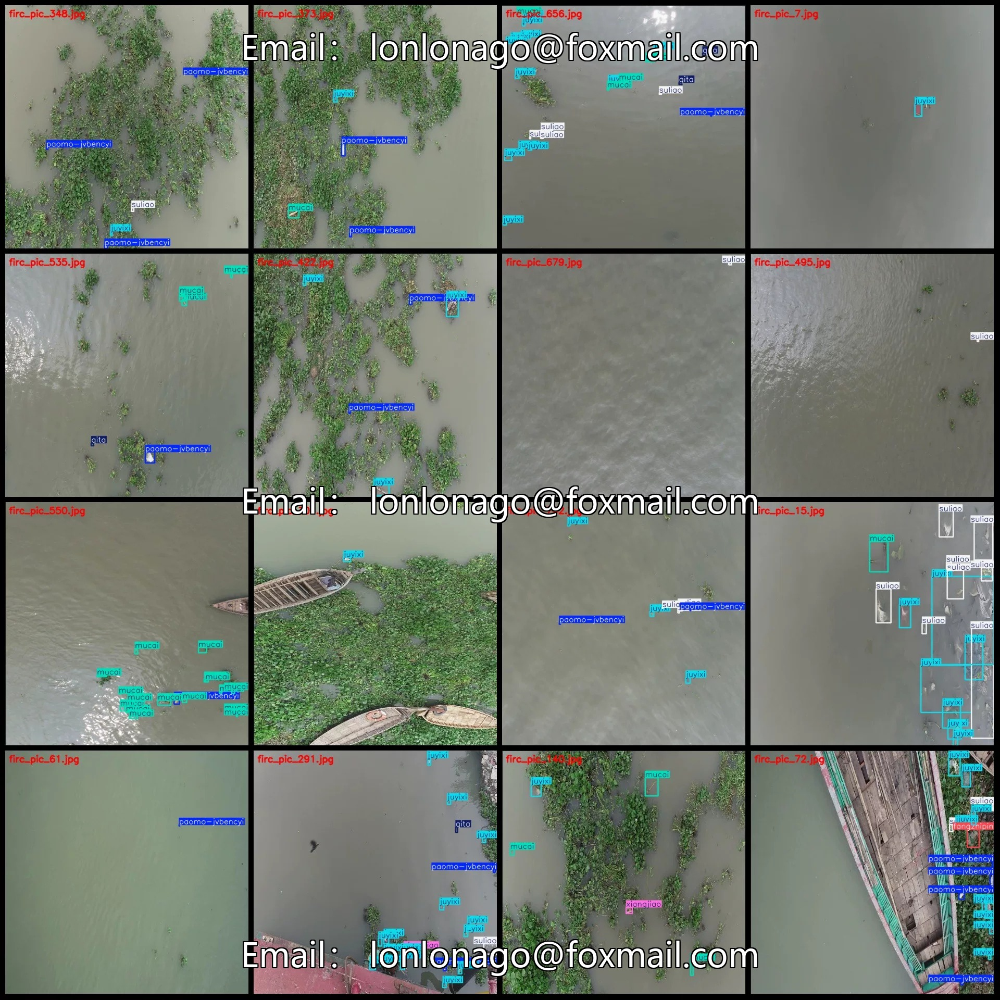
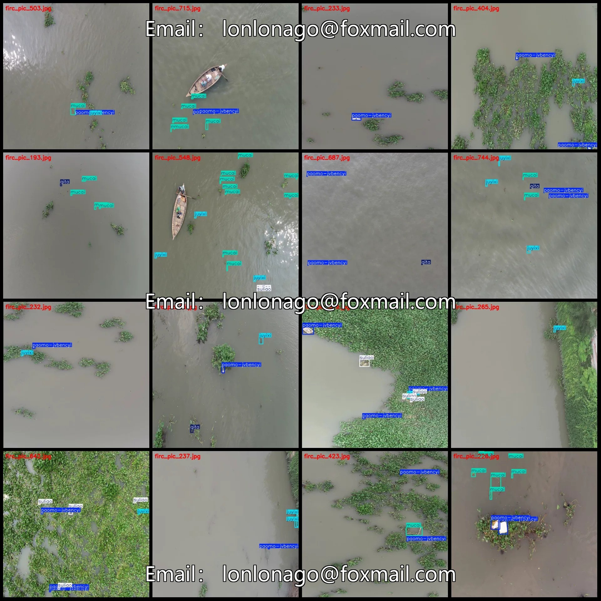
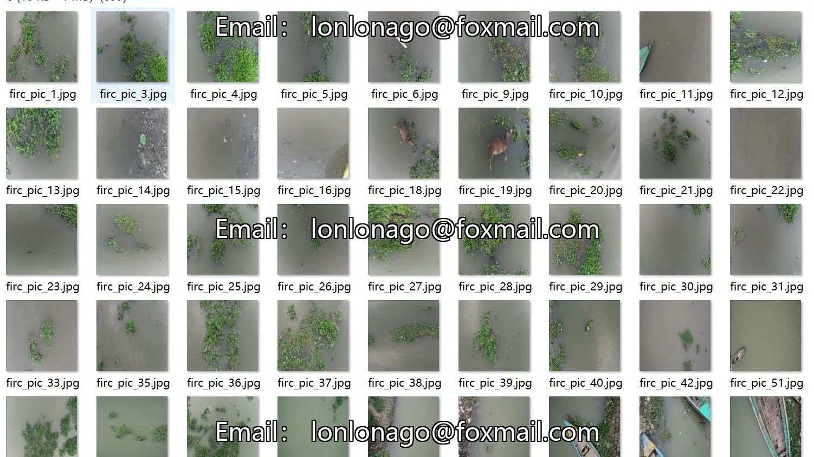
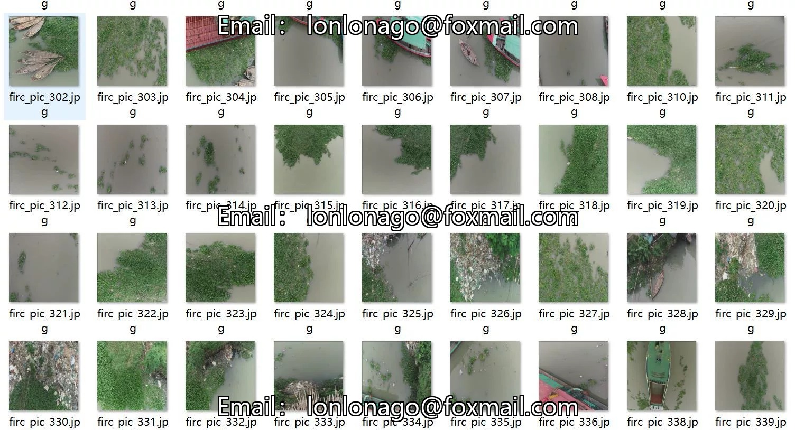
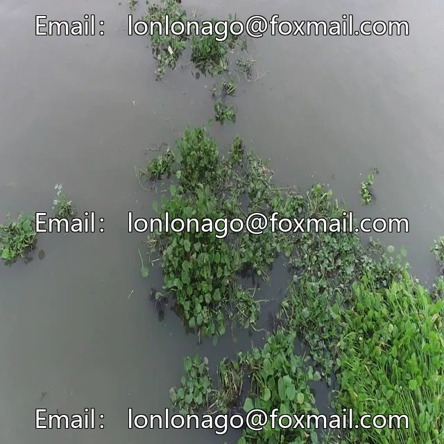
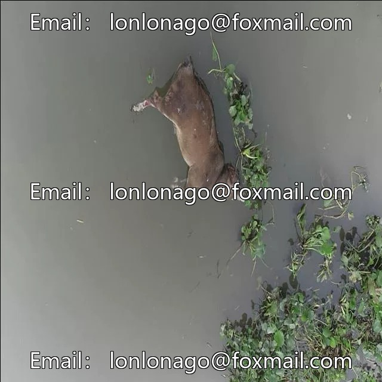
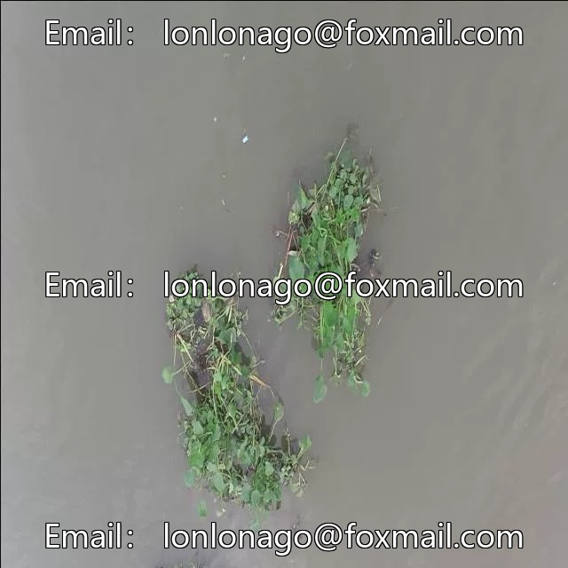

# Drone-view aerial photography dataset for river channel waste detection in VOC+YOLO format with 787 images

## Body

Drone-Viewpoint Aerial Photography Riverbed Waste Detection Dataset VOC+YOLO Format: 787 Images, 9 Categories
Warm Reminder: Due to the dataset's replicability, please confirm compliance with requirements before purchasing.
Note that many targets in the dataset are quite small, and specifics depend on the annotation situation.
Dataset Format: Pascal VOC format + YOLO format (txt file without split path, only containing jpg images along with corresponding VOC format xml files and yolo format txt files)
Number of Images (JPG File Count): 787
Number of Annotations (XML File Count): 787
Number of Annotations (TXT File Count): 787
Number of Annotation Categories: 9

Label category names (Note that the format of YOLO does not correspond to this, but rather follows the order in the labels folder's classes.txt): ["fangzhipin", "juyixi", "mucai", "paomo-jvbencyi", "qita", "suliao", "xiangjiao", "youji", "zhizhang"]
["Textiles", "Polyethylene", "Wood", "Foam-polystyrene", "Others", "Plastics", "Rubber", "Organic", "Paper"]
Number of boxes and the number of images occupied by each category

Fangzhipin Frames = 14, Pictures = 12
Juyixi Frames = 2352, Pictures = 479
Mucai Frames = 1135, Pictures = 288
Paomo-jvbencyi Frames = 1420, Pictures = 494
Other Frames = 149, Pictures = 100
Suliao Frames = 977, Pictures = 336
Xiangjiao Frames = 39, Pictures = 37
Youji Frames = 54, Pictures = 35
Zhizhang Frames = 2, Pictures = 2
Total Frames: 6142
Image Resolution: 640x640

Using labeling tool: labelImg
Labeling rules: Draw a rectangle around the category.
Important note: The dataset does not have separate training, validation, and test sets; you need to partition them yourself.
Special statement: This dataset does not guarantee the accuracy of the trained models or weight files.

## Images

## Payment

Here is a pay link on Stripe ( https://buy.stripe.com/3cs8yP7sY87d0vu9AB ). Please contact me lonlonago@foxmail.com after funding $89, and I will send you a complete data files , thank you!

